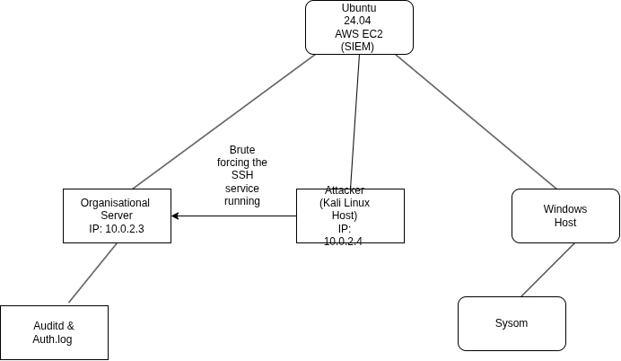
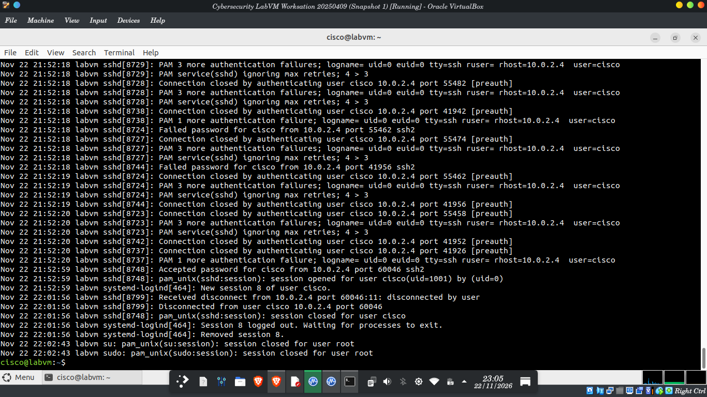
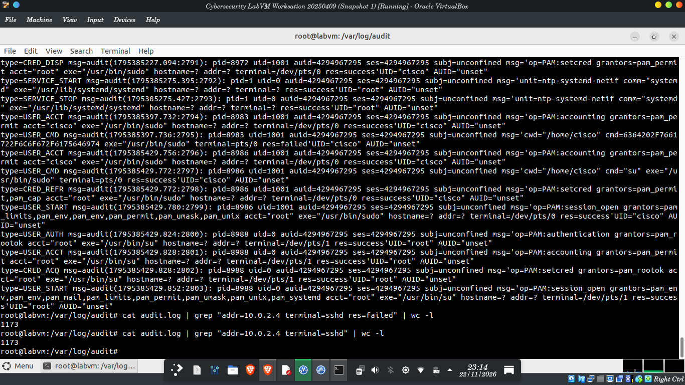
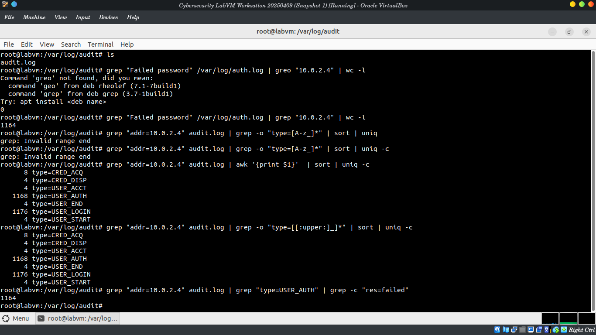
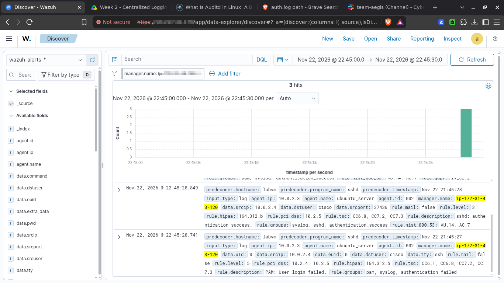
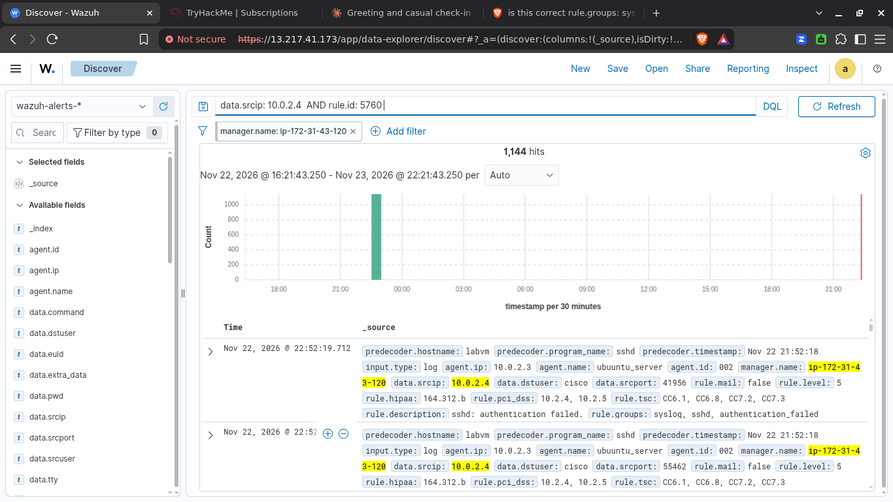
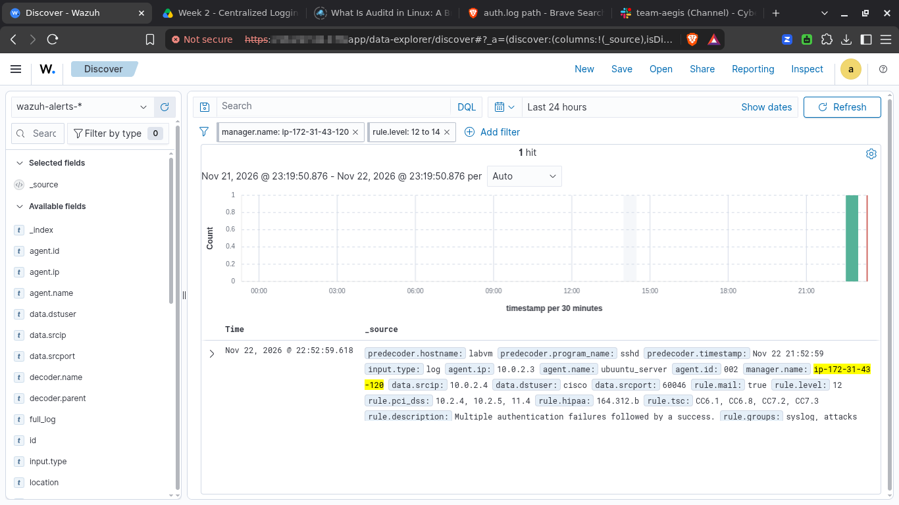
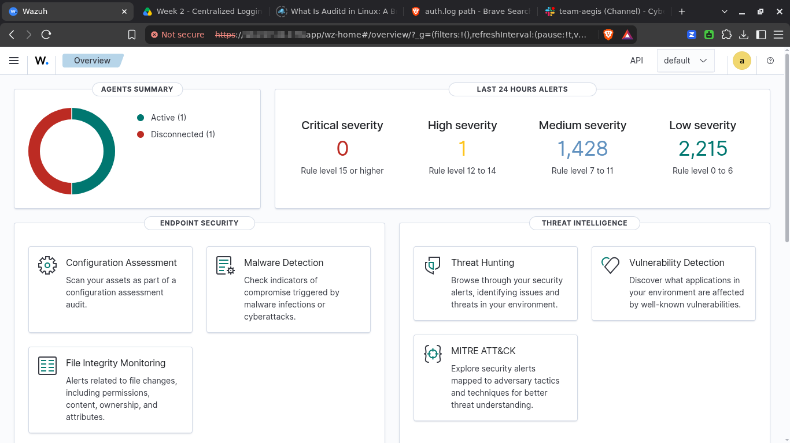
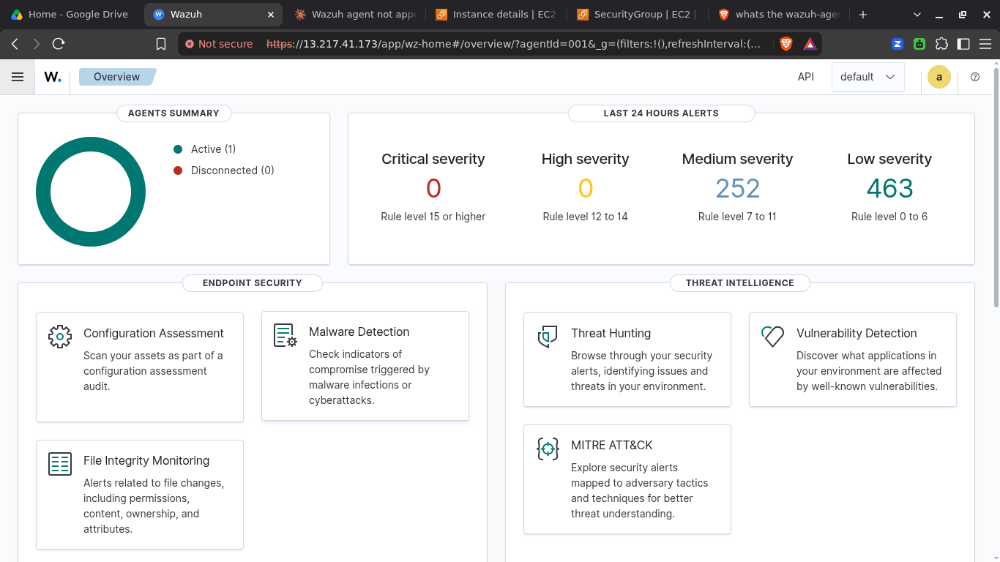
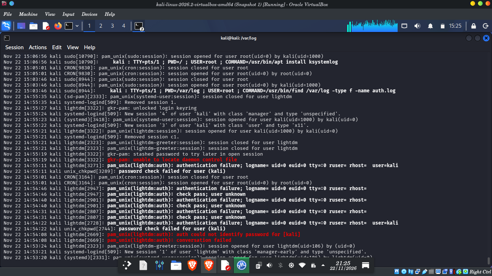

# Week 2 SOC bootcamp

**Status:** In progress

---

## 1. Summary

The attacker on the Kali performed a brute force attempt against the Ubuntu server 10.0.2.3.

---

## 2. Scope and objectives

**Assigned scenarios: **

**Systems in scope:** Server (AWS EC2 instance), Kali Linux 10.0.2.4, Windows 8, Ubuntu Server 10.0.2.3

**Objectives:** Correlate logs from various source and the SIEM i.e Wazuh

**Assumptions:** 

**Exclusions:** 

---

## 3. Lab architecture



*Figure 1: Lab architecture diagram. Ubuntu 24.04 AWS EC2 (SIEM); Organisational Server (IP: 10.0.2.3) with Auditd & Auth.log; Attacker (Kali Linux Host, IP: 10.0.2.4) brute forcing the SSH service running; Windows Host with Sysom.*

| Role | System | IP address | Notes |
| --- | --- | --- | --- |
| Server | AWS EC2 instance | (redacted) | |
| Agent | Kali Linux | 10.0.2.4 | |
| Agent | Windows 8 | not conected | |
| Agent | Ubuntu Server | 10.0.2.3 | |

**Wazuh version: v 4.14.10**

**Networking:**

**Sysmon configuration:**

**Auditd configuration:**

**Time synchronization:**

---

## 4. Setup and methodology

**Build order:**

**Actions performed:**

The attacker on the Kali performed a brute force attempt against the Ubuntu server 10.0.2.3.

**Commands used:**

The number of attempts taken to crack the password was determined using the following command:

```bash
sudo cat /var/log/auth.log | grep "Failed password" | wc -l
```

The audit log count was determined using:

```bash
cat audit.log | grep "addr=10.0.2.4 terminal=sshd" | wc -l
```

The failed authentication records in Auditd were counted using (run from /var/log/audit):

```bash
grep "addr=10.0.2.4" audit.log | grep "type=USER_AUTH" | grep -c "res=failed"
```

**Wazuh search query:**

```
rule.groups: sshd OR rule.groups: "authentication_failed"
```

**Time zone:** UTC +1

---

## 5. Timeline reconstruction

| Time | Host | User | Activity | Evidence source | Figure / Event reference |
| --- | --- | --- | --- | --- | --- |
| 22:45:28.741 | Ubuntu Server 10.0.2.3 | cisco | The attack started | Wazuh | Figure 4 |
| 22:52:21.460 | Ubuntu Server 10.0.2.3 | | The attack ended | Wazuh | |
| 22:52:59.618 | Ubuntu Server 10.0.2.3 | cisco | The attacker successfully logged onto the server | Wazuh | Figure 2, Figure 5 |
| 23:10:30 | Ubuntu Server 10.0.2.3 | cisco | The attacker ran a privileged command (sudo su) | Auditd | Figure 3 |

All times: Nov 22, 2026 (UTC +1).

**Analysis:**

---

## 6. Telemetry analysis

### 6.1 Linux logs (`/var/log/auth.log`)

The /var/log/auth.log kept the details of the brute force made against the server by the attacker.

The result was 1164 entries.

On connecting to the server after bruteforcing the server, the logs showed the attacker IP as 10.0.2.4.

From the logs, the attacker made use of many ports, including 55462, 55458, 41926...



*Figure 2: auth.log on the server showing Failed password entries from 10.0.2.4 and the Accepted password entry for cisco from 10.0.2.4 port 60046.*

**Analysis:**

### 6.2 Auditd

The brute force was also logged by Auditd. Each line in audit.log carries an epoch timestamp, for example msg=audit(1795385429.772...).

From the audit logs, 1173 was the count of the brute force attempt.

In Figure 3, the USER_CMD entry for user cisco (uid=1001) with cmd=su via /usr/bin/sudo carries msg=audit(1795385429.772:2797), which converts to 22:10:29 UTC (23:10:29 UTC +1).

Filtering Auditd to `type=USER_AUTH` with `res=failed` for `addr=10.0.2.4` returns 1164 records, matching the 1164 "Failed password" entries in auth.log (Figure 3b). The larger counts (1168 and 1173) include other record types for the same source address.



*Figure 3: audit.log in /var/log/audit with both grep commands returning 1173. This count is for all records matching addr=10.0.2.4 terminal=sshd.*



*Figure 3b: Terminal in /var/log/audit. The "Failed password" count in auth.log for 10.0.2.4 returns 1164. Counting record types for addr=10.0.2.4 in audit.log shows USER_AUTH 1168 and USER_LOGIN 1176, among others, and filtering USER_AUTH records with res=failed returns 1164.*

**Analysis:**

### 6.3 Wazuh

Wazuh recorded a high severity, which was described as multiple authentication failures followed by a success.

It was classified under the MITRE ATT&CK TECHNIQUE as a Valid Accounts, Brute Force.

Reconstructing the time using Wazuh, the attack started on Nov 22, 2026, at 22:45:28.741 and ended on Nov 22, 2026, at 22:52:21.460 (UTC +1).

Using the search query `rule.groups: sshd OR rule.groups: "authentication_failed"`, a total of 1867 hits was recorded by Wazuh.

At 22:52:59.618 the attacker successfully logged onto the server.

The attacker ran a privileged command at 23:10:30.



*Figure 4: Wazuh Discover, Nov 22, 2026 @ 22:45:00.0 to 22:45:30.0, 3 hits. Alerts shown: "PAM: User login failed." at 22:45:28.741 and "sshd: authentication success." at 22:45:28.849.*



*Figure 4b: Wazuh Discover, query `data.srcip: 10.0.2.4 AND rule.id: 5760`, 1,144 hits between Nov 22, 2026 @ 16:21:43 and Nov 23, 2026 @ 22:21:43. Alerts shown are "sshd: authentication failed." for user cisco from 10.0.2.4, including source ports 41956 and 55462, with the latest at Nov 22, 2026 @ 22:52:19.712.*

**Analysis:**



*Figure 5: Wazuh Discover, Last 24 hours, filter rule.level: 12 to 14, 1 hit at Nov 22, 2026 @ 22:52:59.618: "Multiple authentication failures followed by a success."*

**Analysis:**



*Figure 6: Wazuh Overview. Agents summary: Active (1), Disconnected (1). Last 24 hours alerts: Critical 0, High 1, Medium 1,428, Low 2,215.*



*Figure 6b: Wazuh Overview with agentId=001 in the URL. Agents summary: Active (1), Disconnected (0). Last 24 hours alerts: Critical 0, High 0, Medium 252, Low 463.*

**Analysis:**

### 6.4 Default Windows logs and Sysmon

### 6.5 Other evidence



*Figure 7: Kali Linux terminal (kali@kali) in /var/log showing auth log entries.*

**Analysis:**

---

## 7. Correlation analysis

---

## 8. Visibility comparison matrix

| Activity / question | Windows Logs | Sysmon | Linux Logs | Auditd | Analyst note |
| --- | --- | --- | --- | --- | --- |
| Who performed it? | | Yes | Yes | | The logs showed the attacker IP as 10.0.2.4 |
| What command ran? | | | | | |
| Which process was involved? | | | | | |
| What network connection occurred? | | | Yes | | Many ports, including 55462, 55458, 41926... |
| What file or permission changed? | | | | | |

---

## 9. Visibility gap analysis

| Unanswered question | Why evidence is missing | Required telemetry/configuration | Priority |
| --- | --- | --- | --- |
|Further actions taken by the attackers werent visible | Most likely, a non configured log collector for commands ran  | Wazuh agent > Wazuh Server| HIGH |

---

## 10. Findings and lessons learned
Brute forcing into a server successfully is a large attack surface, since the attacker can elevate privileges as the administrator. 

---

## 11. Recommendations
Root login should be disabled in an organisational server, and the use of weak password should not be tolerated by the security policy. 

---

## 12. Conclusion and management brief

**Final investigation question (YES / PARTIALLY / NO):**
